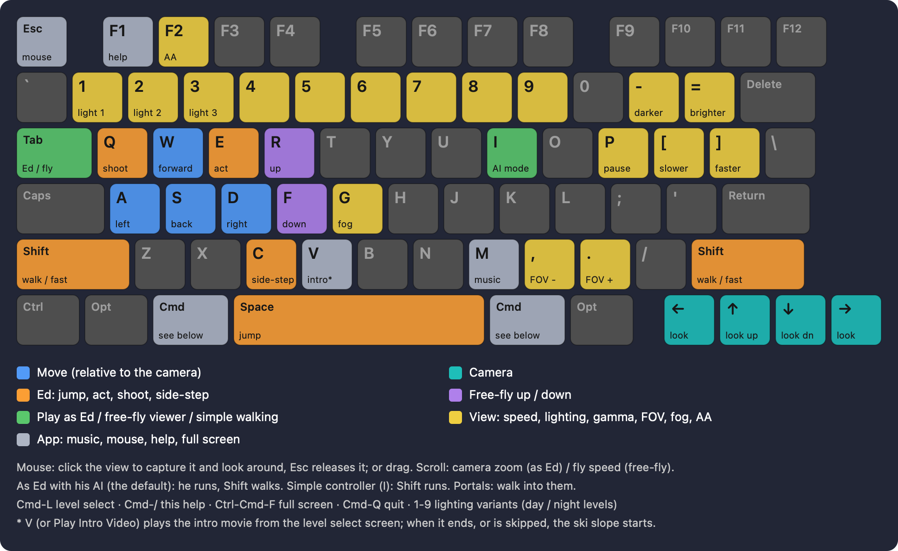

## Open Tonic - open source engine reimplemetation for Tonic Trouble

While still very much a work in progress, enough gameplay has been reproduced to call this a working reimplementation of Tonic Trouble. Let's go through the folder structure:

* core - Tonic Core: a reimplementation of the Tonic Trouble engine. Done entirely assisted by Claude Code, formed from decompiled outputs and previous efforts to reverse engineer Rayman 2 (Open Rayman, namely). The raymap project also helped a lot with correct rendering of levels, though there is still work to be done on that end, namely with global and persos lighting.
* docs - various notes taken throughout the project, haphazard documentation, mostly Claude-speak. Their main purpose is for Claude to note down progress and know where work needs to be picked up. It's definitely human-readable, but a lot of it may be self-contradicting and out of date.
* files - where you'll be placing your own game assets and where the game's own converted files live (sources/ and out/ respectively)
* sdl - an example SDL3 graphics frontend built on top of Tonic Core, tested and working under Linux Mint 22.3 on an Intel Celeron J4125 Linux box
* Sources/OpenTonic - the root of this project which began as Tonic Viewer: a Swift graphics frontend that wraps around Tonic Core to render game levels natively on macOS via Metal APIs. It was the first target platform and the reason this repository is still a Swift package. The project evolved as I began iterating upon a "simple Ed walking mode", which is still accessible in the game alongside a free-camera exploration mode (see the controls pictogram at the end of this README for complete information). Tested and working under an M1 Pro MacBook with 16GB unified memory.
* tools - Tonic Tools: all the scripts needed to extract and build game files. make_app.sh builds and installs for macOS, install_linux.sh self-documents what it builds and installs for. The packages produced by the build scripts must obviously never be posted anywhere as they're filled to the brim with Ubisoft copyrighted assets.
  
  
 
The project is firmly in Beta territory, with a lot of outstanding work needing to be done. Just about everything is rough around the edges or still unimplemented. For now it acts more like a proof of concept and exploration of the game itself. You can essentially simulate a playthrough by starting with Ski Slope (totalski) and sequentially going through portals. You can also play the intro video and skip / watch until the end, the first level begins afterwards.

 

The next steps for the project consist of further decompilation and implementation of actual game mechanics. For now, you're not actually able to interact with power-ups or enemies and a lot of the game engine code needs work. I don't intend this to be a 1-to-1 replication of the original game; I'm aiming more for something like Tonic Trouble: Remastered, with the added freedom of being able to build new levels for Ed to explore and play around in.

### Controls

Open this pictogram in the game by pressing F1.
